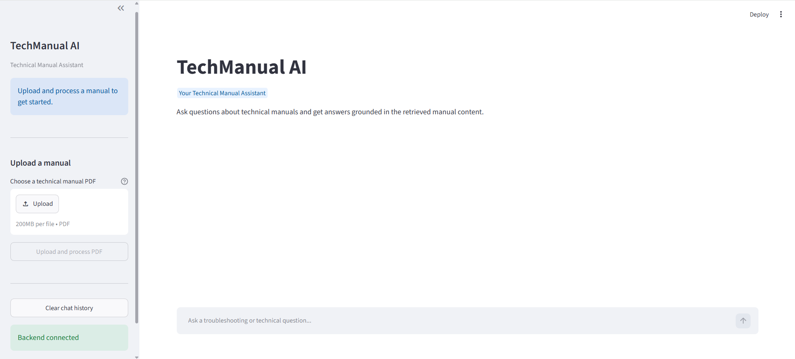
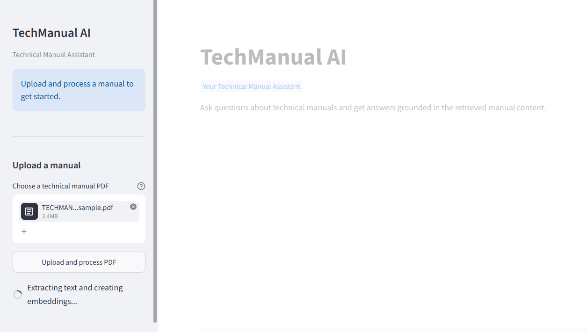
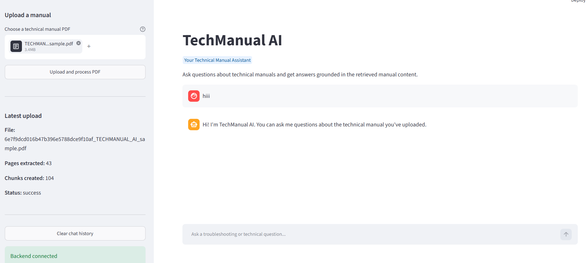
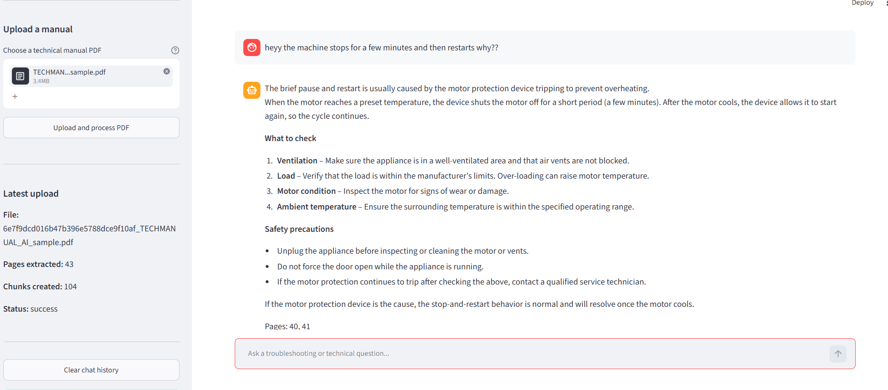

# TechManual AI — Technical Manual Q&A with RAG

TechManual AI is a Retrieval-Augmented Generation (RAG) application that helps technicians and product support teams find accurate, model-specific information from technical manuals in PDF format.

Instead of manually searching through lengthy manuals, users can upload a PDF and ask questions in natural language. The application retrieves relevant content from the document and generates an answer grounded in the retrieved context.

## Features

- **PDF Upload:** Upload technical manuals directly through the interface.
- **Document Processing:** Extract text from PDFs and split it into smaller chunks.
- **Vector Database:** Store document embeddings in a local Chroma vector database for semantic retrieval.
- **Context-Aware Q&A:** Retrieve relevant manual sections and generate answers using an LLM.
- **Streaming Responses:** Display generated answers progressively in the chat interface.
- **Interactive UI:** Chat with uploaded manuals through a Streamlit frontend.
## Screenshots









## How It Works

```text
              User uploads PDF
                     |
                     v
            PDF Text Extraction
                     |
                     v
               Text Chunking
                     |
                     v
             Generate Embeddings
                     |
                     v
          Store Vectors in Chroma
                     |
                     v
User Question --> Retrieve Relevant Chunks
                     |
                     v
            Build Contextual Prompt
                     |
                     v
                Groq LLM
                     |
                     v
        Stream Answer with Page Numbers
```

### RAG Pipeline

1. **Ingestion:** Extract text and page information from the uploaded PDF.
2. **Chunking:** Split extracted text into manageable chunks for retrieval.
3. **Embedding:** Convert the chunks into vector representations using the configured embedding model.
4. **Storage:** Save vectors and associated document metadata in Chroma.
5. **Retrieval:** Search for chunks semantically related to the user's question.
6. **Generation:** Pass the retrieved context to the LLM to generate a grounded response.
7. **Streaming:** Send the response to the Streamlit interface as it is generated.

## Project Structure

```text
techmanual-ai/
│
├── backend/
│   ├── main.py
│   └── services/
│       ├── ingestion.py
│       ├── retrieval.py
│       └── generation.py
│
├── frontend/
│   └── app.py
│
├── data/
│   ├── chroma/
│   └── uploads/
│
├── .env
├── .gitignore
├── requirements.txt
└── README.md
```


## Getting Started

### 1. Clone the Repository

```bash
git clone https://github.com/vaishnaviparabkar90/TechManual_AI.git
cd TechManual_AI
```

### 2. Create and Activate a Virtual Environment

```bash
python -m venv .venv
```

On Windows:

```bash
.venv\Scripts\activate
```

### 3. Install Dependencies

```bash
pip install -r requirements.txt
```

### 4. Configure Environment Variables

Create a `.env` file in the project root and add your Groq API key:

```env
GROQ_API_KEY=your_groq_api_key
```

Keep your API key private. Never commit your `.env` file to GitHub.

### 5. Start the FastAPI Backend

From the project root, run:

```bash
python -m uvicorn backend.main:app --reload
```

Open the API documentation at:

http://127.0.0.1:8000/docs

### 6. Start the Streamlit Frontend

Open a second terminal, activate the same virtual environment, and run:

```bash
streamlit run streamlit_app.py
```


### TechManual AI can help answer questions such as:

- What could cause an unpleasant odour in the washing machine?
- What are the possible causes of clothes becoming wrinkled?
- Which spin speed is recommended for sportswear?
- What precautions should be taken regarding water pressure?
- Which troubleshooting steps are recommended for a specific issue?

Answers depend on the content of the uploaded manual.

## Author

Vaishnavi Parabkar :)

GitHub: vaishnaviparabkar90